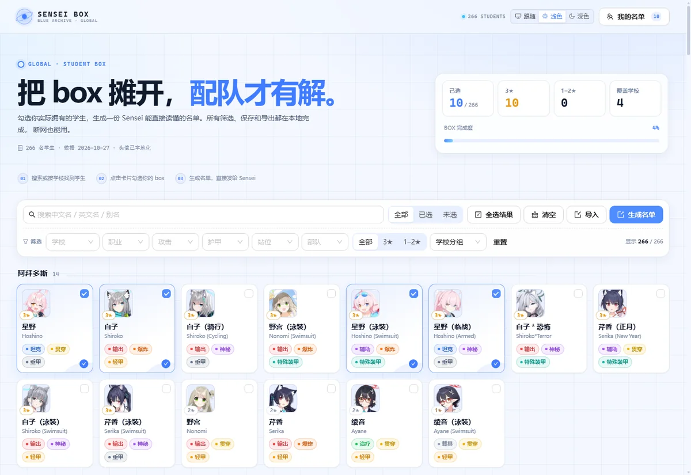
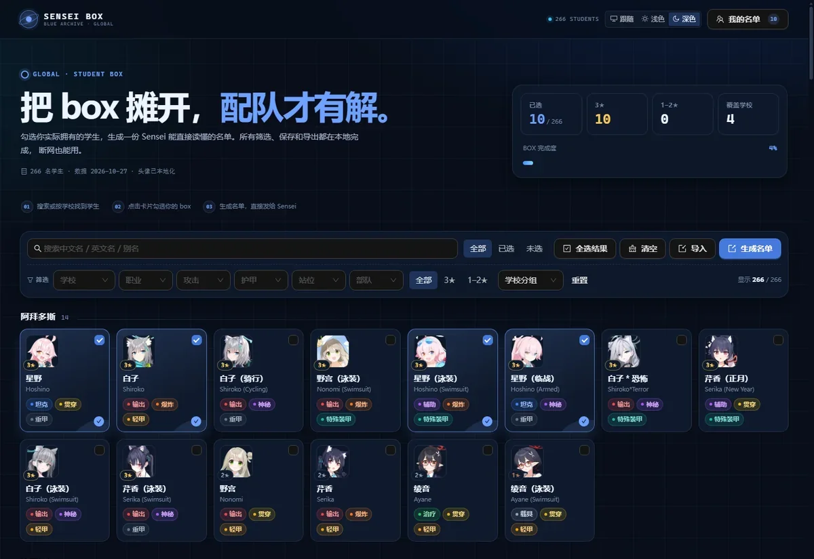

# ba-sensei-box

[](https://github.com/LumiDesk/ba-sensei-box/actions/workflows/ci.yml)
[](LICENSE)

> 蔚蓝档案（国际服）离线学生清单：勾选你的 box，生成一份 Sensei 能直接读懂的名单。

`ba-sensei-box` 是一个纯前端、离线优先的学生持有清单工具。它把国际服当前已实装的学生做成可筛选的卡片墙，点选后生成一份包含名单码、可读名单和 JSON 的交付物，方便后续配队讨论。

- 仓库：<https://github.com/LumiDesk/ba-sensei-box>
- 在线预览：<https://ba-sensei-box.vercel.app>





## 特性

- **266 名国际服学生**：中文名 + 英文名、头像、学校、星级、职业、攻击 / 护甲、站位、突击 / 支援。
- **离线可用**：生产构建是单个 `index.html`，头像在 `dist/students/icons/`，双击即可打开，不需要服务器。
- **Ant Design 界面**：表格化筛选、抽屉、Modal、Tag、Button 等基础组件来自 Ant Design，不手搓组件库。
- **深浅色主题**：跟随系统 / 浅色 / 深色，偏好保存在浏览器；首屏脚本避免刷新闪白。
- **筛选与搜索**：按学校、星级、职业、攻击、护甲、站位、部队筛选；支持中文、英文、社区别名。
- **自动保存**：勾选状态、目标内容、账号等级、备注保存在 `localStorage`。
- **可交付**：约 50 字符的名单码、可读分组名单、可下载 JSON；支持导入名单码或 JSON 恢复。
- **可维护**：Vite + React + TypeScript + SCSS，Oxlint、Prettier、Vitest，数据同步脚本可重复执行。

## 快速开始

要求 Node.js 24+、pnpm 12+。

```bash
pnpm install
pnpm dev
```

开发服务器默认在 `http://localhost:5173`。

## 构建离线网页

```bash
pnpm build
```

构建产物：

```text
dist/
├─ index.html          # JS/CSS 已内联，双击可打开
├─ favicon.svg
└─ students/icons/     # 266 张本地 WebP 头像
```

直接双击 `dist/index.html` 即可使用。**不要只复制 index.html**：头像在旁边的 `students/icons/` 目录里，需要一起移动。整个 `dist/` 可以直接压缩后发给别人。

## 数据更新

学生资料与头像来自 [SchaleDB](https://schaledb.com/)，只取 `IsReleased[1] === true` 的国际服学生。

```bash
pnpm data:sync            # 更新 JSON，保留已下载头像
pnpm data:sync -- --force # 强制重新下载全部头像
```

脚本会：

1. 拉取 SchaleDB 的简中 / 英文学生数据；
2. 过滤国际服已实装学生；
3. 按中文名去重（例如 `星野（临战）` 的重复行）；
4. 保留已有学生的 `order`，新学生追加到末尾；
5. 下载缺失头像到 `public/students/icons/`；
6. 写入 `src/data/students.generated.json`。

`order` 是名单码的稳定索引，**只能追加，不能重排或删除已有学生**；否则旧名单码会解码错误。详细规则见 [docs/data-pipeline.md](docs/data-pipeline.md)。

## 名单码

名单码格式：

```text
SB1-<Base64URL(bitset + checksum)>
```

- 位图按学生的 `order` 写入，不依赖数组顺序；
- 最后 1 字节是校验和，复制漏字符会直接报错；
- 只记录“拥有哪些学生”，不包含账号、UID 或任何个人信息；
- 同一条码可以反复导入；新版本追加学生不会破坏旧码。

示例（只勾选阿露）：

```text
SB1-AQAAAAAAAAAAAAAAAAAAAAAAAAAAAAAAAAAAAAAAAAAAAB8
```

实现与测试在 `src/features/roster/roster-codec.ts` 和 `roster-codec.test.ts`。

## 项目结构

```text
src/
├─ app/                 App 外壳与 Ant Design Provider
├─ components/
│  ├─ layout/           Header / Footer
│  ├─ roster/           清单页业务组件（卡片、工具栏、抽屉、导入导出）
│  └─ ui/               领域小组件（TypeChip、StatTile）
├─ data/                生成数据、类型、分类表、别名
├─ features/
│  ├─ roster/           持有状态、筛选、名单码、导入导出、持久化
│  └─ theme/            主题上下文与偏好
├─ lib/                 剪贴板、下载等无业务工具
├─ pages/               页面编排
└─ styles/              设计令牌、mixin、全局样式
```

## 常用命令

| 命令                                | 作用                                     |
| ----------------------------------- | ---------------------------------------- |
| `pnpm dev`                          | 启动开发服务器                           |
| `pnpm build`                        | 类型检查 + 生产构建                      |
| `pnpm preview`                      | 预览构建产物                             |
| `pnpm lint`                         | Oxlint                                   |
| `pnpm lint:fix`                     | Oxlint 自动修复                          |
| `pnpm typecheck`                    | TypeScript                               |
| `pnpm test`                         | Vitest                                   |
| `pnpm format` / `pnpm format:check` | Prettier                                 |
| `pnpm check`                        | format + lint + typecheck + test + build |
| `pnpm data:sync`                    | 从 SchaleDB 同步学生与头像               |

## 技术栈

- Vite 8 + React 19 + TypeScript 6
- Ant Design 6 + `@ant-design/icons`
- SCSS（设计令牌 + 语义类）
- `vite-plugin-singlefile`（离线单文件构建）
- Oxlint 1.90、Prettier 3、Vitest 5

## 文档

- [AGENTS.md](AGENTS.md)：工程约定、命令、数据与提交规则
- [DESIGN.md](DESIGN.md)：设计令牌、布局、组件与主题规范
- [docs/architecture.md](docs/architecture.md)：模块边界与数据流
- [docs/data-pipeline.md](docs/data-pipeline.md)：数据源、去重、`order` 与头像同步
- [.agents/notes](.agents/notes/README.md)：关键决策记录

## 版权与许可

代码以 [MIT](LICENSE) 许可发布。学生资料、名称与头像版权归 NEXON Games / Yostar 所有；本项目是非官方粉丝工具，不提供游戏账号数据，也不与官方关联。详见 [THIRD_PARTY_NOTICES.md](THIRD_PARTY_NOTICES.md)。
